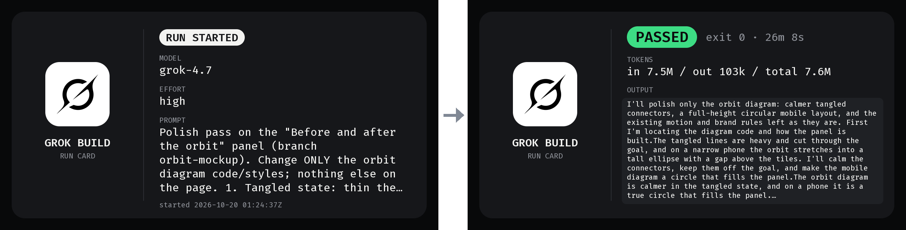
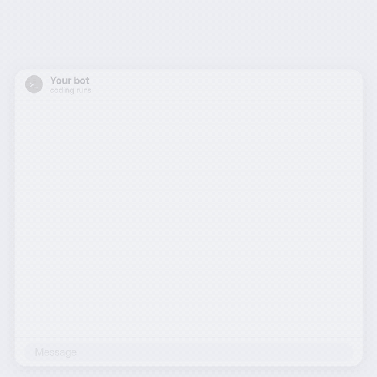

# run-cards

**You started a coding run and walked away. run-cards gives you a card when it starts and an honest one when it ends, so you know whether it really finished and can share its progress with anyone.**

Built for Grok Bot: Grok Bot agents run Grok Build and Claude Code through run-cards and post the opening and closing cards as images in the Grok Bot chat. It also works as a plain CLI wrapper anywhere.



Put `run-cards` in front of a Grok Build or Claude Code command. The CLI runs exactly as it normally would. Before the run starts you get an **opening card** (tool, model, effort, prompt). When it ends you get a **closing card** (how it ended, how long it took, tokens, the start of the output). Each card is a 1200×630 PNG plus a short Markdown version for text-only chats.

The Grok and Claude logos appear on cards only to show which tool ran. They belong to their owners. **Not affiliated with xAI or Anthropic, and not an official Grok Bot product.**

## Built for Grok Bot

run-cards was made by [R Creative](https://rcreative.ai) for Grok Bot agents that write code. The agent starts a coding run with `run-cards grok ...` or `run-cards claude ...`, posts `open.png` in the chat when the run starts, and posts `close.png` when it ends. That way the person in the chat sees what each coding run did and how it really ended, without reading logs.

## Why

- **Know how it really ended.** Some runs exit with "success" but never finished: an approval nobody could give, a cancelled turn. Those cards say **BLOCKED** or **CANCELLED**, not PASSED.
- **Share progress mid-run.** Each card's path is printed the moment it's written, so you can post the opening card while the run is still going.
- **Nothing changes for the CLI.** Live output and the exit code pass straight through. Scripts that check `$?` keep working.
- **Timeouts still get a closing card.** If a run hangs, you get a TIMED OUT card instead of silence.
- **Secrets stay off the cards.** API keys, tokens and passwords are masked on the cards and in the run record.
- **No dependencies.** Node.js and the CLI you already use. No native builds. 145 tests.

## Quick start

You need Node.js 18.17 or newer and `grok` and/or `claude` installed.

**1. Get it onto your PATH**

```bash
git clone https://github.com/rystedtcreative/run-cards.git ~/src/run-cards
ln -s ~/src/run-cards/bin/run-cards ~/.local/bin/run-cards
```

**2. Run your CLI with `run-cards` in front**

```bash
run-cards grok -p "fix the failing test in tests/api" --output-format json
run-cards claude -p "fix the failing test in tests/api" --output-format json
```

(`--output-format json` is optional. It's what puts token counts on the closing card.)

**3. Pick up the cards**

As each card is written, its path is printed to stderr:

```
run-cards: open-card /home/you/.cli-run-cards/runs/<run-id>/open.png
run-cards: close-card /home/you/.cli-run-cards/runs/<run-id>/close.png
```

Post them wherever your team follows the work. run-cards never uploads anything itself.



## What the cards show

| Card | What it means |
|------|---------------|
| **RUN STARTED** | The opening card. Written before the CLI starts: tool, model, effort, prompt. |
| **PASSED** | Exit code 0, and the run actually finished. |
| **FAILED** | Non-zero exit code. The error output is shown on the card. |
| **TIMED OUT** | The run passed the time limit (1 hour by default for headless runs) and was stopped. Exit code 124. |
| **CANCELLED** | Exit code 0, but the turn was cancelled or hit the max-turns limit. |
| **BLOCKED** | Exit code 0, but a permission or approval was denied and no file edit got through. |

Closing cards also show the exit code, duration, tokens (when the CLI reports them) and the first lines of the output.

## More

- [Install options](docs/install.md): PATH setup, `npm link`, `scripts/install.sh`, transparent `grok` / `claude` aliases
- [Usage](docs/usage.md): flags, running headless, exit codes, interactive mode
- [Cards and output files](docs/cards.md): card fields, Markdown cards, where files go, the stderr path-line format, run ids, `run.json`
- [How BLOCKED and CANCELLED are detected](docs/outcomes.md)
- [Configuration](docs/configuration.md): environment variables
- [Secrets and data handling](docs/security.md)
- [Adding another CLI](docs/adapters.md)
- [Development](docs/development.md): tests, previews, font and logo rendering, code layout

## License

[MIT](LICENSE). Fira Code is under the SIL Open Font License ([`assets/fonts/OFL.txt`](assets/fonts/OFL.txt)). The Grok and Claude logos are trademarks of their owners; see [`assets/logos/README.md`](assets/logos/README.md).
