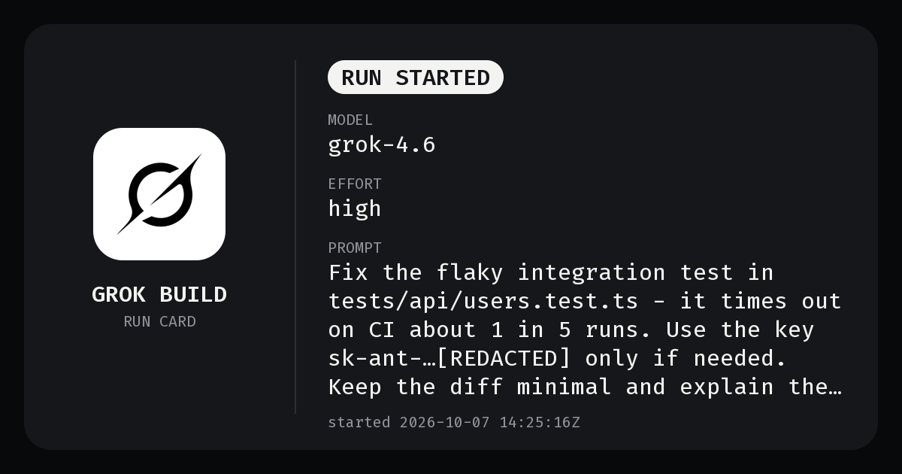
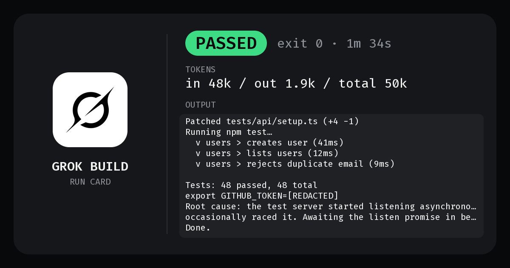
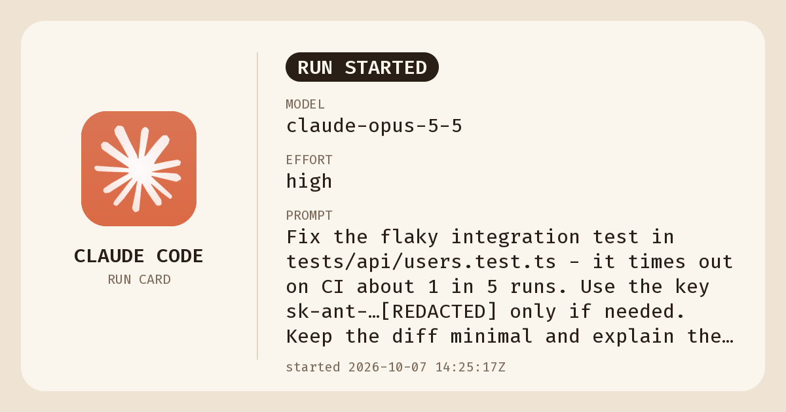
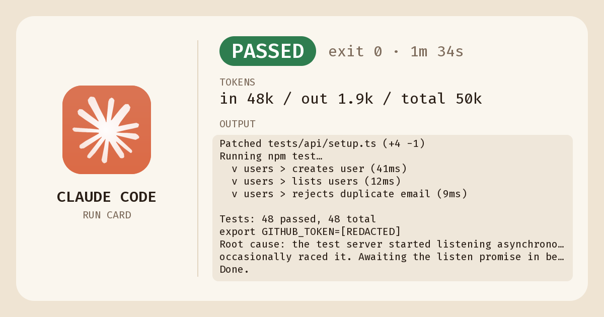

# Cards and output files

[← Back to the README](../README.md)

## Card examples

Sample opening and closing cards for a passing run. `npm run preview` regenerates these into `./preview/` (git-ignored); the copies shown here are committed under `docs/screenshots/`.

### Grok




### Claude




## Where cards go

```
~/.cli-run-cards/                      # or $CLI_RUN_CARDS_DIR
  latest.json                          # { runDir, status, exitCode, cards: {open, close, openMd, closeMd}, sidecar }
  runs/20261007-134350-d3ae3c/         # <UTC timestamp>-<random id>
    open.png                           # 1200×630, written BEFORE the CLI starts
    open.md                            # same opening card as Markdown text (+ repo / branch)
    close.png                          # 1200×630, written AFTER it exits
    close.md                           # same closing card as Markdown text (+ repo / branch / commit)
    run.json                           # sidecar (masked)
```

With `CLI_RUN_CARDS_RUN_ID=<id>` the run dir is `runs/<id>/` instead of `<timestamp>-<random>` (see [Choosing the run id](cards.md#choosing-the-run-id)).

The wrapper doesn't upload anything. Callers post the cards themselves. To find them, read the **path lines** the wrapper prints to stderr as each file lands:

```
run-cards: open-card /home/you/.cli-run-cards/runs/20261007-134350-d3ae3c/open.png
run-cards: open-md /home/you/.cli-run-cards/runs/20261007-134350-d3ae3c/open.md
run-cards: close-card /home/you/.cli-run-cards/runs/20261007-134350-d3ae3c/close.png
run-cards: close-md /home/you/.cli-run-cards/runs/20261007-134350-d3ae3c/close.md
run-cards: run-json /home/you/.cli-run-cards/runs/20261007-134350-d3ae3c/run.json
```

- `open-card` then `open-md` are printed right after `open.png` / `open.md` are written, **before** the CLI is started, so a caller can post the opening card while the run is still going.
- `close-card`, `close-md`, then `run-json` are printed after the CLI exits (including on timeout), once `close.png` / `close.md` are written and `run.json` has been rewritten with the final state. `run.json` is on disk before its line is printed.
- The format is a stable API: each line is exactly `run-cards: <open-card|open-md|close-card|close-md|run-json> <absolute path>` followed by `\n`, with nothing else on the line (`^run-cards: (open-card|open-md|close-card|close-md|run-json) /\S.*$`). Each appears at most once per run, interleaved with the CLI's own stderr. The `-md` kinds are new names, so an existing grep for `open-card` / `close-card` still matches only the PNG lines.
- A card that fails to write isn't announced (the `could not write …` warning is printed instead).
- On by default. `CLI_RUN_CARDS_QUIET=1` turns them off, leaving stderr byte-identical to the CLI's. `CLI_RUN_CARDS_DISABLED=1` writes no cards, so it prints no lines either.
- `CLI_RUN_CARDS_VERBOSE` is deprecated and does nothing: the old end-of-run `run-cards: cards: …` line was replaced by these lines, so paths are never printed twice.


### Posting cards

- **Text-only chats**: post the **text of `open.md` / `close.md`** as the message. Read the file at the `open-md` / `close-md` path and paste its contents; don't paste the path.
- **Chats with images**: attach the **PNGs** (`open.png` / `close.png`).


The `.md` cards are compact Markdown: a bold header with the tool and status (▶️ RUN STARTED / ✅ PASSED / ❌ FAILED / ⏱️ TIMED OUT / ⏹️ CANCELLED / ⛔ BLOCKED), exit code and duration, a `Why:` line for cancelled/blocked runs, model, effort, repo, branch, a one-line prompt summary (≤ 200 chars), the commit the run made (`Commit: <sha> <subject>`, `(+N more)` for several, or `Commit: none`), tokens if reported, and the start of the output (≤ 8 lines / 900 chars) in a code fence. For example:

````markdown
**Grok Build · ✅ PASSED** · exit 0 · 4m 26s
Model: `grok-4.7` · Effort: high
Repo: `acme/widgets` · Branch: `feat/demo`
Prompt: Fix the flaky integration test in tests/api/users.test.ts …
Commit: `0b78c8f` fix(tests): await server.listen before the first request
Tokens: in 48k / out 1.9k / total 50k

Output (start):
```
Found race: server.listen() not awaited before first request
Patched tests/api/setup.ts (+4 -1)
Tests: 48 passed, 48 total
```
````

Repo is `owner/name` from the `origin` remote (credentials in the URL are dropped), else the folder name; branch and commit come from `git` in the CLI's working directory (Grok's `--cwd` if given). Outside a git work tree the repo and commit lines are left out. Text is secret-masked like the PNGs.

`latest.json` is still written after each run, but it's racy with concurrent runs; prefer the path lines or a run id you chose.

### Choosing the run id

Set `CLI_RUN_CARDS_RUN_ID=<id>` to decide the run directory up front: the run goes to `<root>/runs/<id>/` (root = `$CLI_RUN_CARDS_DIR` or `~/.cli-run-cards`) and `run.json`'s `id` is `<id>`. Rules:

- `<id>` must match `^[A-Za-z0-9][A-Za-z0-9._-]{0,127}$` and must not contain `..`. So no slashes, no leading dot/dash/underscore, at most 128 characters.
- The directory must not exist yet. It's created with a non-recursive `mkdir`, so two runs can't share an id.
- If either check fails, the wrapper prints a `run-cards: …` error to stderr and exits **2 without starting the CLI**. An existing directory is left untouched.
- An empty value counts as unset (generated id). With `CLI_RUN_CARDS_DISABLED=1` the variable is ignored, since no run dir is created.
- Other failures to create the directory (e.g. an unwritable root) behave as before: a warning, and the CLI still runs without cards.

`run.json` holds the masked full prompt, masked args, model, effort, repo, branch, status (plus `reason` and `outcome: { stopReason, edits, permissionDenials }` when detected), the commit the run made (if any), exit code, signal, timed-out flag, start/end time, duration, tokens (if any), the masked summary lines, card paths, and any non-fatal wrapper errors. `run.json` is rewritten at start (`status: "running"`) and again at the end, so a crashed run still leaves a record.

### Cards

Both cards are 1200×630 PNGs. The left column always has the tool's official logo in a rounded tile, the wordmark (GROK BUILD / CLAUDE CODE) and "RUN CARD".

**Opening card** (written before the CLI starts):

| Field | Source |
|-------|--------|
| RUN STARTED pill | always |
| Model | Grok: `-m/--model`, else `[models] default` in `~/.grok/config.toml`. Claude: `--model`, else `$ANTHROPIC_MODEL`, else `model` in `~/.claude/settings.json` (or `$CLAUDE_CONFIG_DIR`). Else "default" |
| Effort | Grok: `--reasoning-effort/--effort` or config. Claude: `--effort`, else `effortLevel` in settings.json. **Row omitted if unknown** |
| Prompt | whitespace-collapsed, secret-masked, wrapped and truncated with "…". Claude `-p` with no positional prompt shows "(prompt on stdin)" |
| started | UTC start time |

**Closing card** (written after it exits):

| Field | Source |
|-------|--------|
| Status pill | PASSED (exit 0) / FAILED / TIMED OUT / CANCELLED / BLOCKED, plus exit code, signal (if any) and duration |
| Tokens | in / out / total, **only when the CLI reports them** (structured output); row omitted otherwise |
| Output | first ~12 lines (configurable) of the final response, word-wrapped (or raw stdout), secret-masked. On failure, stderr is appended so the error shows up |

Bot names and ticket ids are deliberately not shown.

Themes: **Grok** is a dark charcoal card with light text and the black-on-white Grok mark. **Claude** is a warm cream card with the cream-on-terracotta Claude mark. Render sample cards for both tools to `./preview/` with `npm run preview`, or see [Card examples](cards.md#card-examples).
